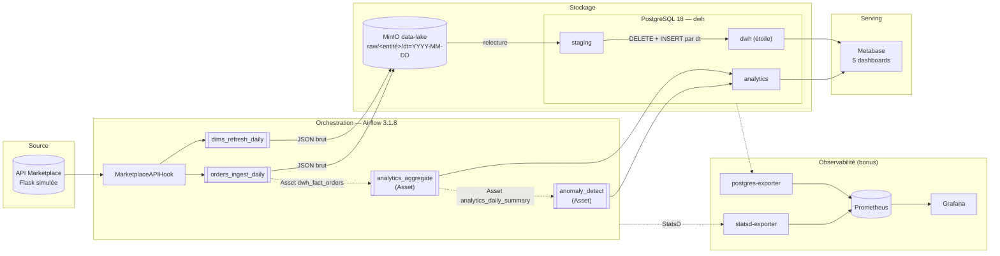
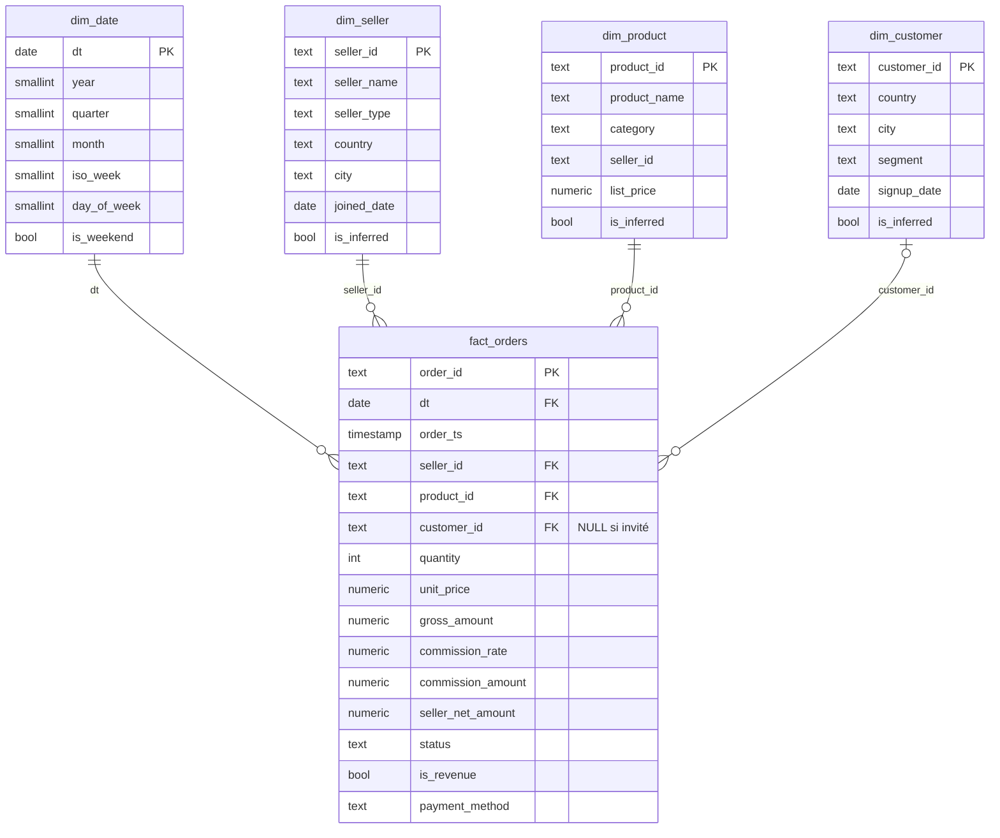

# MarketPlace Analytics - Maelys Marketplace

MVP de plateforme data pour **Maelys Marketplace** : ingestion automatique des données du backoffice,
Data Warehouse en étoile, KPIs dans Metabase et détection d'anomalies commerciales.

> Projet A - cahier des charges v3.0 · Stack : Airflow 3.1.8 · PostgreSQL 18 · MinIO · Metabase 0.59 · Prometheus/Grafana

---

## 1. Architecture



### Déroulé d'un run (`marketplace_orders_ingest_daily`, date `{{ ds }}`)

```mermaid
sequenceDiagram
    participant S as Scheduler
    participant H as MarketplaceAPIHook
    participant A as API Marketplace
    participant M as MinIO
    participant P as PostgreSQL
    S->>H: extract_orders_to_raw(ds)
    H->>A: GET /orders?date=ds (Bearer, retry sur 5xx/timeout)
    A-->>H: JSON (~8 500 commandes)
    H->>M: PUT raw/orders/dt=ds/data.json
    S->>M: load_staging_orders : relit le JSON brut
    S->>P: DELETE + INSERT staging.orders WHERE dt = ds
    S->>P: DataQualityOperator (non vide, non NULL, pas de date future)
    alt qualité OK
        S->>P: BEGIN; DELETE + INSERT dwh.fact_orders WHERE dt = ds; COMMIT
        S-->>S: publie l'Asset dwh_fact_orders → DAG analytics → DAG anomalies
    else qualité KO
        S-->>S: alert_dq_failure (le DWH n'est pas touché, le run passe en échec)
    end
```

**Pourquoi ces choix**

- **MinIO comme couche brute** : le chargement relit le JSON depuis MinIO, pas depuis l'API ni l'XCom. Si une transformation a un bug, on la corrige puis on rejoue sans rappeler la source.
- **3 schémas** : `staging` (copie typée de l'API), `dwh` (modèle en étoile), `analytics` (agrégats pour les dashboards, plus les journaux de qualité et d'anomalies).
- **Pas de Spark ni de dbt** : ~8 500 lignes par jour, donc du SQL exécuté par `PostgresHook` suffit largement.

---

## 2. Démarrage rapide

Prérequis : Docker Desktop (≥ 6 Go de RAM alloués), ports libres 8080, 5433, 5000, 9000, 9001, 3000.

```bash
# 1. Lancer la stack (le premier build prend quelques minutes)
docker compose up -d --build
docker compose ps            # attendre que tous les services soient "healthy" (~1-2 min)

# 2. Charger les dimensions, puis une journée de commandes
docker compose exec airflow-worker airflow dags test marketplace_dims_refresh_daily 2026-04-07
docker compose exec airflow-worker airflow dags test marketplace_orders_ingest_daily 2026-04-07

# 3. (Optionnel) historique pour les dashboards : backfill de 30 jours
docker compose exec airflow-worker airflow dags unpause marketplace_orders_ingest_daily
docker compose exec airflow-worker airflow backfill create --dag-id marketplace_orders_ingest_daily \
    --from-date 2026-09-20 --to-date 2026-10-20 --max-active-runs 4

# 4. Créer automatiquement les dashboards Metabase (Python 3 sur l'hôte, sans dépendance)
python metabase/setup_metabase.py

# 5. Tests
docker compose exec airflow-worker pytest tests/ -v
```

Le fichier `.env` est **optionnel** : chaque variable a une valeur par défaut dans le `docker-compose.yaml`.
Pour les surcharger, copier `.env.example` en `.env`.

| Service | URL / accès | Identifiants |
|---|---|---|
| Airflow | http://localhost:8080 | `airflow` / `airflow` |
| Metabase | http://localhost:3000 | `admin@maelys.local` / `Admin2026!` |
| Console MinIO | http://localhost:9001 | `minio_admin` / `minio_password_2026` |
| API Marketplace | http://localhost:5000/health | Bearer `formation-token-2026` |
| PostgreSQL DWH | `psql -h localhost -p 5433 -U dwh_user -d dwh` | `dwh_password_2026` |
| Grafana (bonus) | http://localhost:3001 | `admin` / `admin` |
| Prometheus (bonus) | http://localhost:9090 | — |

---

## 3. Services Docker Compose

| Service | Port hôte | Volume | Rôle |
|---|---|---|---|
| `airflow-apiserver` | 8080 | — | UI et API REST |
| `airflow-scheduler`, `-dag-processor`, `-triggerer`, `-worker` | — | — | Airflow en CeleryExecutor |
| `airflow-init` | — | — | Migration de la base et création de l'utilisateur admin (s'exécute une fois) |
| `postgres-airflow` | *(non exposé)* | `pg-airflow-data` | Base de métadonnées d'Airflow |
| `postgres-dwh` | 5433 | `pg-dwh-data` | Data Warehouse, initialisé par `init-db/schema.sql` |
| `redis` | *(non exposé)* | — | Broker Celery |
| `minio` / `minio-init` | 9000 / 9001 | `minio-data` | Stockage objet ; `minio-init` crée le bucket `data-lake` |
| `api-marketplace` | 5000 | — | API Flask simulée (`api/`) |
| `metabase` | 3000 | `metabase-data` | BI (les dashboards survivent à un `down -v` grâce au volume) |
| `statsd-exporter` | 9102 | — | Métriques Airflow au format Prometheus |
| `prometheus`, `grafana`, `postgres-exporter` | 9090, 3001, 9187 | `prometheus-data`, `grafana-data` | Profil `monitoring` (bonus) |

> `postgres-airflow` et `redis` ne sont pas exposés sur l'hôte : ils n'en ont pas besoin, et cela évite les
> conflits avec un PostgreSQL local déjà installé sur le port 5432.

---

## 4. Source de données : l'API simulée (`api/app.py`)

Aucun jeu de données n'étant fourni, l'API génère des données **déterministes** :

- les commandes d'un jour dépendent de `seed = md5(date)`, donc **même date = même réponse** (c'est ce qui permet de prouver l'idempotence) ;
- le catalogue est fixe : 2 400 vendeurs (artisans, DNVB, revendeurs), 18 000 produits répartis dans 10 catégories (1/10 du catalogue réel) et 20 000 clients ;
- volume : ~8 500 commandes par jour, avec une saisonnalité hebdomadaire (plus de ventes le week-end) et une légère croissance ;
- réalisme : popularité très inégale entre vendeurs (loi de Pareto), environ 6 % de vendeurs qui arrêtent de vendre, 2 % de commandes en invité, des statuts `cancelled` et `refunded` ;
- anomalies volontairement injectées pour tester la détection : environ 4 % des jours ont un **incident** (CA divisé par 2 à 3), et environ 0,1 % des commandes ont un **prix aberrant** (×10, ×100 ou ×0,01).

Ordres de grandeur obtenus : CA (GMV) ≈ 1,3 M€ par jour, commission Maelys ≈ 140 k€ par jour, soit **≈ 4,2 M€ de revenu mensuel** (cohérent avec le sujet).

| Endpoint | Paramètres | Réponse |
|---|---|---|
| `GET /health` | — | `{status, version}` (pas d'authentification) |
| `GET /orders` | `date=YYYY-MM-DD` | `{date, count, orders: [...]}` |
| `GET /sellers` | `limit` (optionnel) | `{count, sellers: [...]}` |
| `GET /products` | — | `{count, products: [...]}` |
| `GET /customers` | `limit` (optionnel) | `{count, customers: [...]}` |

`API_FAILURE_RATE=0.3` dans `.env` fait renvoyer des erreurs 503 aléatoires, pour voir le retry du Hook à l'œuvre.

---

## 5. Modèle de données (`init-db/schema.sql`)



- **Grain** de `fact_orders` : une ligne par commande.
- **`is_revenue`** vaut FALSE pour les commandes `cancelled` ou `refunded`. Le CA et la commission ne comptent que les commandes valides (commission = 12 %).
- **`analytics`** contient `daily_summary`, `seller_daily`, `category_daily`, `anomalies`, `dq_check_results` et la vue `v_seller_activity` (vendeurs inactifs).
- **Index** : sur `fact_orders(dt)`, `(seller_id, dt)` et `(product_id)`, pour les DELETE par partition et les dashboards.

**Choix de modélisation**

- **Clés naturelles comme clés primaires des dimensions** : le SCD2 est explicitement hors périmètre (« Won't have »), donc les dimensions sont en SCD1 (écrasement des attributs). Une clé de substitution n'apporterait rien et compliquerait les jointures dans Metabase.
- **Membres inférés (late-arriving dimensions)** : si une commande référence un vendeur ou un produit pas encore chargé, le pipeline commandes crée une ligne minimale (`is_inferred = TRUE`) pour respecter les FOREIGN KEY, au lieu d'échouer. Le DAG des dimensions complète ensuite ses attributs. Les deux DAGs peuvent ainsi tourner dans n'importe quel ordre.
- **`dim_date`** est pré-remplie de 2023 à 2030 par `generate_series`.

---

## 6. DAGs

| DAG | Schedule | Rôle |
|---|---|---|
| `marketplace_dims_refresh_daily` | `@daily` | API → MinIO → `staging.{sellers,products,customers}` → upsert SCD1 de `dim_*` |
| `marketplace_orders_ingest_daily` | `@daily` | Pipeline principal : extract → raw → staging → qualité → branchement → `fact_orders` → purge du staging |
| `marketplace_analytics_aggregate_daily` | Asset `dwh_fact_orders` | Reconstruit `daily_summary`, `seller_daily` et `category_daily` pour les dates reçues |
| `marketplace_anomaly_detect_daily` | Asset `analytics_daily_summary` | Détecte les baisses de CA (< 70 % de la moyenne 7 jours) et les prix suspects (> 5× ou < 0,2× le prix catalogue) |

```
extract_orders_to_raw >> load_staging_orders >> dq_check_staging_orders >> branch_on_dq
branch_on_dq >> [transform_fact_orders >> purge_old_staging, alert_dq_failure]
```

- **`catchup=False`** sur tous les DAGs, **2 retries** par tâche, `max_active_runs` borné.
- **`{{ ds }}` = la journée traitée** : avec `AIRFLOW__SCHEDULER__CREATE_CRON_DATA_INTERVALS=true`, un run `@daily` lancé le 21 traite le 20 (comportement d'Airflow 2). Sans ce réglage, Airflow 3 prendrait la date du déclenchement.
- **Assets** : l'ingestion publie l'événement `dwh_fact_orders` avec `extra={"dt": ds}`. Le DAG analytics agrège exactement les dates reçues (lors d'un backfill, plusieurs dates arrivent en un seul run). Lancé à la main sans événement, il reconstruit toutes les dates.
- **Anomalies** : le sujet suggère `@daily`. Nous avons préféré un déclenchement par Asset, qui garantit que la détection tourne **après** l'agrégation (pas de course entre DAGs).

### Custom Hook — `plugins/marketplace/hooks/marketplace_api_hook.py`

- Hérite de `BaseHook` et lit la Connection `marketplace_api` (`host` = URL, `password` = token Bearer). **Aucun token dans le code** : la Connection est injectée par variable d'environnement (`AIRFLOW_CONN_MARKETPLACE_API`).
- Méthodes : `get_orders(day)`, `get_sellers(limit)`, `get_products()`, `get_customers(limit)`, `health()` et `test_connection()` (pour le bouton « Test » de l'UI).
- Retry avec backoff exponentiel sur timeout, erreur réseau, 429 et 5xx. Échec immédiat sur 400, 401 ou 404, car réessayer ne changerait rien.
- Une seule `requests.Session` par Hook, ce qui le rend facile à mocker dans les tests.

### Custom Operator — `plugins/marketplace/operators/data_quality_operator.py`

`DataQualityOperator(table, partition_filter, check_not_empty, not_null_columns, no_future_date_column, fail_on_error, results_table)` :
trois règles configurables, `partition_filter` templatable (`"dt = '{{ ds }}'"`), et des résultats historisés dans
`analytics.dq_check_results`. Il renvoie `{"passed", "row_count", "failures"}`, que la tâche `branch_on_dq` utilise pour choisir entre le load DWH et l'alerte.

---

## 7. Idempotence

Toutes les écritures sont partitionnées par `dt` et passent par `marketplace.db.run_in_transaction` / `replace_rows` :
**DELETE de la partition puis INSERT, dans une seule transaction**, avec ROLLBACK si une requête échoue.

```sql
BEGIN;
  -- membres inférés (INSERT ... ON CONFLICT DO NOTHING)
  DELETE FROM dwh.fact_orders WHERE dt = %(dt)s;
  INSERT INTO dwh.fact_orders (...) SELECT ... FROM staging.orders WHERE dt = %(dt)s;
COMMIT;
```

La date n'est jamais écrite en dur : elle vient de `{{ ds }}` et est passée en paramètre psycopg2 (ce qui évite aussi les injections SQL).
Un test vérifie qu'aucune date n'apparaît en dur dans le SQL.

**Test manuel (celui du cahier des charges, vérifié sur ce projet)** :

```bash
docker compose exec airflow-worker airflow dags test marketplace_orders_ingest_daily 2026-04-07
docker compose exec postgres-dwh psql -U dwh_user -d dwh -c "SELECT COUNT(*) FROM dwh.fact_orders WHERE dt='2026-04-07';"
# -> 8431
docker compose exec airflow-worker airflow dags test marketplace_orders_ingest_daily 2026-04-07
docker compose exec postgres-dwh psql -U dwh_user -d dwh -c "SELECT COUNT(*) FROM dwh.fact_orders WHERE dt='2026-04-07';"
# -> toujours 8431 (et même SUM(gross_amount) = 1 281 860,53 €)
```

### Rejouer une date passée / backfill (US-06)

```bash
# une date
docker compose exec airflow-worker airflow dags test marketplace_orders_ingest_daily 2026-04-07
# une plage (le scheduler exécute les runs ; analytics et anomalies suivent via les Assets)
docker compose exec airflow-worker airflow backfill create --dag-id marketplace_orders_ingest_daily \
    --from-date 2026-10-14 --to-date 2026-10-20 --max-active-runs 4
```

Grâce au pattern DELETE + INSERT, rejouer une plage déjà chargée ne crée aucun doublon.

---

## 8. Dashboards Metabase

`python metabase/setup_metabase.py` crée le compte admin, la source **DWH Marketplace** (host `postgres-dwh`, port interne
`5432`), toutes les questions SQL et les dashboards. Le script est rejouable : un dashboard déjà présent est ignoré.
« Dernier jour » désigne la dernière date chargée (J-1).

| Dashboard | Contenu | User story |
|---|---|---|
| 1 - Executive Summary | Indicateurs du dernier jour (CA, commandes, panier moyen, commission), courbe du CA sur 30 jours, top 5 vendeurs du jour | US-01, US-02 |
| 2 - Top Sellers | Top 10 du mois, évolution des top 3 sur 30 jours, table des vendeurs inactifs (> 7 jours sans vente) | US-02 |
| 3 - Commissions (Finance) | Commission du mois, taux effectif, annulations, commission par jour, récapitulatif journalier | US-03 |
| 4 - Catégories | Répartition et évolution du CA par catégorie, panier moyen par catégorie | US-04 |
| 5 - Anomalies & qualité | Anomalies détectées, CA comparé à la moyenne mobile 7 jours, derniers contrôles qualité | US-05 |

---

## 9. Tests (`tests/`)

```bash
docker compose exec airflow-worker pytest tests/ -v      # 35 tests
```

| Fichier | Ce qui est testé |
|---|---|
| `test_dags.py` | Import sans erreur, `catchup=False`, retries et tags, ordre des tâches, **transformation idempotente** (DELETE avant INSERT sur la même partition), aucune date en dur, Asset publié et consommé |
| `test_marketplace_hook.py` | Token lu depuis la Connection, retry sur 503 et sur timeout, abandon après N tentatives, pas de retry sur 401, validation de la date (`requests` mocké) |
| `test_data_quality_operator.py` | Les 3 règles, `fail_on_error`, champ templaté (PostgresHook mocké) |
| `test_idempotence.py` | Base mockée : DELETE puis INSERT dans une transaction, ROLLBACK en cas d'erreur. **Intégration** : 3 rejeux sur la vraie base donnent un résultat identique (ignoré si la base est inaccessible) |
| `test_api.py` | Authentification, déterminisme (`md5(date)`), validation des paramètres |

---

## 10. Observabilité (bonus)

```bash
docker compose --profile monitoring up -d
```

- Airflow envoie ses métriques StatsD à `statsd-exporter` (`monitoring/statsd_mapping.yml` les convertit en métriques Prometheus avec les labels `dag_id` et `task_id`).
- `postgres-exporter` expose les métriques du DWH : connexions, requêtes, verrous.
- Grafana (http://localhost:3001) a sa source Prometheus déjà provisionnée. Il reste à importer les dashboards
  **11010** (Airflow Cluster) et **9628** (PostgreSQL Database) via *Dashboards → Import*.
- Supervision du pipeline (US-07) : `airflow_dagrun_duration_failed`, `airflow_ti_finish{state="failed"}`.

---

## 11. Écarts assumés par rapport au cahier des charges

| Sujet | Choix | Raison |
|---|---|---|
| Image MinIO | `bitnamilegacy/minio:2025.4.22` | Les images `minio/minio` et `minio/mc` ont été retirées de Docker Hub fin 2025. C'est le même serveur MinIO (RELEASE.2025-04-22), qui embarque `mc`. |
| Kit et données | API et compose écrits par l'équipe | Aucun kit ni dataset n'était imposé |
| DAG anomalies | Déclenché par Asset au lieu de `@daily` | Garantit qu'il tourne après l'agrégation |
| Ports 5432 et 6379 | Non exposés | Inutiles depuis l'hôte, et évitent les conflits locaux |
| Image Airflow | `apache/airflow:3.1.8` + `pytest` (`airflow/Dockerfile`) | Pour lancer `pytest` dans le worker |

## 12. Ce qu'on ferait avec plus de temps

- **dbt** pour les transformations : lineage, tests de données et documentation générée.
- **Great Expectations** à la place du `DataQualityOperator`.
- Alertes **Slack ou e-mail** réelles (callbacks `on_failure_callback`, `notify_anomalies`).
- Base de métadonnées Metabase sur PostgreSQL plutôt que H2 (niveau production).
- Partitionnement natif PostgreSQL de `fact_orders` par mois, et une politique de cycle de vie sur MinIO.
- CI (lint, pytest, `docker compose config`) et dimensions en SCD2 si l'historique des attributs devient utile.

---

## 13. Arborescence

```
Projet_Final_Marketplace/
├── docker-compose.yaml        # stack complète (+ profil monitoring)
├── .env.example               # variables surchargeables
├── airflow/                   # image Airflow 3.1.8 + pytest
├── api/                       # API Flask simulée (déterministe)
├── init-db/schema.sql         # schémas staging / dwh / analytics
├── dags/                      # 4 DAGs
├── plugins/marketplace/
│   ├── hooks/marketplace_api_hook.py
│   ├── operators/data_quality_operator.py
│   ├── sql.py                 # toutes les requêtes (idempotentes)
│   ├── db.py                  # exécution transactionnelle
│   ├── events.py              # lecture des événements d'Asset
│   └── config.py              # connexions, Assets, constantes
├── metabase/setup_metabase.py # création des dashboards via l'API
├── monitoring/                # Prometheus, StatsD mapping, Grafana
├── tests/                     # 35 tests pytest
└── docs/                      # cahier des charges
```

## 14. Dépannage

| Symptôme | Solution |
|---|---|
| Un nouveau DAG n'apparaît pas | Il est détecté en 30 s maximum. Sinon : `docker compose exec airflow-worker airflow dags list-import-errors` |
| Le DAG analytics ne se déclenche pas | Vérifier qu'il n'est pas en pause dans l'UI (il est créé actif) |
| `Cannot connect` dans Metabase | Host `postgres-dwh` et port `5432` (et non `localhost:5433`) |
| Bucket `data-lake` absent | `docker compose up minio-init` |
| Reset complet | `docker compose down -v` (supprime aussi les dashboards Metabase) |
